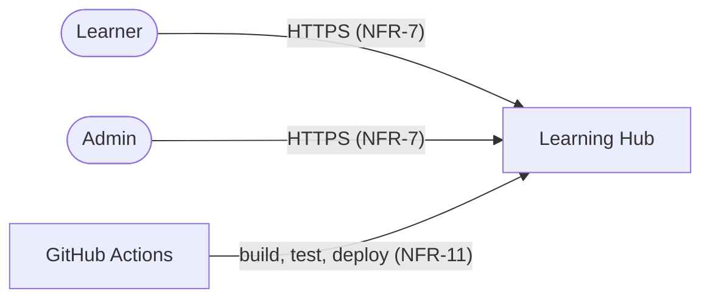
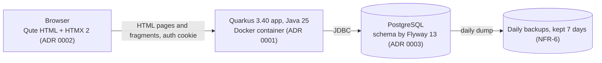
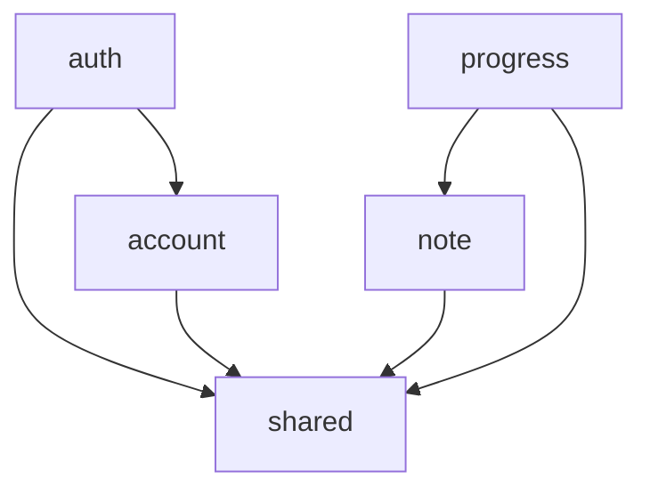
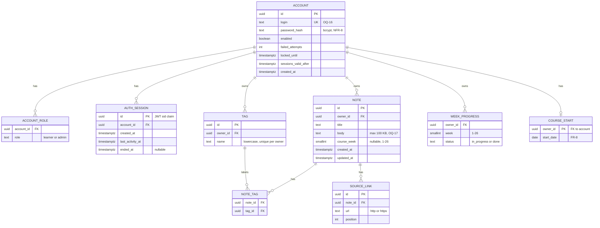

# Learning Hub — Architecture

Status: Draft v0.1 · Date: 2026-11-12 · Sources: docs/requirements.md, docs/adr/0001-0004
Scope: phase 2 (FR-1 to FR-9). Every element below cites the FR or NFR it exists for.

## 1. Context and containers

| Container | Purpose | Requirements |
|-----------|---------|--------------|
| Browser | Renders server HTML; HTMX swaps fragments. No build step. HTMX pinned to 2.0.11 and served by the app from `/static`, no CDN. | FR-1..FR-9, ADR 0002 |
| Quarkus app | All business rules, auth, Markdown rendering, HTML templates. Single deployable. | FR-1..FR-9, NFR-5 |
| PostgreSQL | Only data store. Every user-data row has an owner. | FR-3..FR-9, NFR-3 |
| Backups | Automatic daily dump, 7-day retention, restore tested before week 7. | NFR-6 |

Hosting and backup providers are not decided yet (future ADR). They must be free tier (NFR-1),
HTTPS only (NFR-7), and answer the first request after idle within 30 s (NFR-5).

## 2. Modules

Package by feature. Each module owns its tables, templates and endpoints.
A module exposes only its `api` sub-package; everything else is internal.

| Module | Responsibility | FRs | Owns tables |
|--------|----------------|-----|-------------|
| `shared` | Problem details, validation mapping, current-user lookup, base layout template | cross-cutting | — |
| `account` | Accounts, roles, Admin create / disable / reset password, first Admin bootstrap | FR-2 | `account`, `account_role` |
| `auth` | Sign-in, sign-out, lockout, sessions, inactivity timeout, JWT cookie | FR-1 | `auth_session` |
| `note` | Notes, tags, source links, Markdown rendering, search and filters, ownership checks | FR-3, FR-4, FR-5, FR-6, FR-7, FR-9 | `note`, `tag`, `note_tag`, `source_link` |
| `progress` | Course start date, week statuses, notes per week, overall progress | FR-8, FR-9 | `course_start`, `week_progress` |

Allowed dependencies (enforced by an ArchUnit test in CI):

- A module may call only another module's `api` package. No access to another module's entities or tables.
- No cycles. `account` never calls `auth`: disable and reset set `account.sessions_valid_after`,
  and `auth` checks it on every request (FR-2).
- `progress` reads note counts per week through `note.api` (FR-8). It never queries `note` tables.
  It keeps the course start date in its own `course_start` table, so it needs no access to `account`.
- `note` and `progress` get the current user's id from `shared` (current-user lookup), not from
  `account` or `auth`. Their `owner_id` columns are foreign keys to `account.id` at database level only.
- `shared` depends on no feature module.
- Schema order: the `account` table is created first with only `id`, `login`, `created_at`, because
  `owner_id` needs it. Sign-in columns and the other `account` and `auth` tables are added later by new
  migrations (ADR 0003). Dev and test profiles seed two learner accounts from a separate Flyway
  location that is never enabled in production.

## 3. API

Server-rendered HTML (ADR 0002). Forms and HTMX requests send form data; responses are full pages
or HTML fragments. Every endpoint except sign-in and health requires a valid session (FR-1).
Role `learner` endpoints always filter by the current user's id (FR-9).

| Method | Path | Role | Purpose | FR |
|--------|------|------|---------|----|
| GET | `/login` | anonymous | Sign-in form | FR-1 |
| POST | `/login` | anonymous | Check credentials, lockout, start session | FR-1 |
| POST | `/logout` | any signed-in | End current session | FR-1 |
| GET | `/admin/accounts` | admin | List accounts (no note data) | FR-2, FR-9 |
| POST | `/admin/accounts` | admin | Create account with initial password and roles | FR-2 |
| POST | `/admin/accounts/{id}/disable` | admin | Disable account, end its sessions | FR-2 |
| POST | `/admin/accounts/{id}/password` | admin | Set new initial password, end sessions | FR-2 |
| GET | `/` | any signed-in | Redirect to `/notes` (learner) or `/admin/accounts` | FR-1 |
| GET | `/notes?q=&tag=&week=&page=` | learner | List, search and filter own notes, 20 per page | FR-6, FR-7, FR-9 |
| GET | `/notes/new` | learner | New-note form with data-policy notice | FR-3, FR-9 |
| POST | `/notes` | learner | Create note with tags, links, week | FR-3, FR-4 |
| GET | `/notes/{id}` | learner | Show note with rendered Markdown | FR-5, FR-9 |
| GET | `/notes/{id}/edit` | learner | Edit form with data-policy notice | FR-5, FR-9 |
| PUT | `/notes/{id}` | learner | Save changes (FR-3 and FR-4 rules apply) | FR-5, FR-4 |
| DELETE | `/notes/{id}` | learner | Delete permanently | FR-5 |
| GET | `/progress` | learner | 26 weeks: dates, note counts, status, highlight, overall % | FR-8 |
| PUT | `/progress/start-date` | learner | Set course start date | FR-8 |
| PUT | `/progress/weeks/{week}` | learner | Set week status | FR-8 |
| GET | `/q/health/ready` | anonymous | Readiness for deploy and warm-up checks | NFR-5, NFR-11 |

Rules:
- A note id that is unknown or owned by another user returns the same 404 (FR-9).
- `PUT` and `DELETE` are sent by HTMX (`hx-put`, `hx-delete`) (FR-5, FR-8).
- Authentication (ADR 0004, applies once it is accepted in week 6): Quarkus security with SmallRye JWT;
  passwords hashed with bcrypt (NFR-8); the JWT is kept in an `HttpOnly`, `Secure`, `SameSite=Strict`
  cookie, so scripts cannot read it and other sites cannot trigger state changes (FR-1, FR-9).
  Role checks use `@RolesAllowed("learner")` and `@RolesAllowed("admin")` on every resource;
  `/login` and `/q/health/ready` are the only `@PermitAll` endpoints. The signing key comes from an
  environment variable (section 5).

## 4. Data model

- Ownership: `note`, `tag`, `week_progress` and `course_start` carry `owner_id`; every query filters by it (FR-9).
  Tags are per owner, so tag names never leak between users.
- Constraints in the database as well as in code: `course_week` and `week` between 1 and 26,
  `status` check, unique `(owner_id, name)` on `tag`, unique `(owner_id, week)` on `week_progress`
  (FR-3, FR-4, FR-8).
- No `week_progress` row means "not started" (FR-8). No `course_start` row means no start date, so no
  week is highlighted. Week dates are derived from `course_start.start_date`, not stored.
- Delete is a hard delete with `ON DELETE CASCADE` to `note_tag` and `source_link` (FR-5).
  Orphan tags are removed in the same transaction.
- Indexes: `note(owner_id, updated_at desc)` for listing (FR-6, NFR-4). Text search starts as a
  case-insensitive match on title and body; a `pg_trgm` or full-text index is added if OQ-1 or the
  NFR-4 measurement requires it.
- Session validity (FR-1, FR-2): a request is accepted only if the JWT signature and `exp` are valid,
  the `auth_session` row is not ended, `last_activity_at` is within 8 hours, the account is enabled, and
  the session was created after `sessions_valid_after`. This refines the revocation check in ADR 0004.
- Token lifetime (ADR 0004): the JWT is short-lived (default 15 min, config value) and carries the
  `auth_session` id as `sid`. When a request passes all checks above and the token is older than half
  its lifetime, the app issues a new token in the same cookie. Ending the session therefore stops
  renewal at once, and the 8-hour inactivity rule depends only on `last_activity_at` (OQ-15).
- Migrations (ADR 0003): SQL files in `src/main/resources/db/migration`, named
  `V<n>__<description>.sql`, applied with `quarkus.flyway.migrate-at-start=true`. A migration that has
  been merged is never edited; changes are new forward migrations. CI runs Flyway `validate`.

## 5. Cross-cutting

### Errors (RFC 9457)
- All errors are modelled as problem details: `type`, `title`, `status`, `detail`, `instance`,
  plus an `errors` extension with `{field, message}` for validation (FR-3, FR-4, FR-8 must name the
  field or the limit).
- One JAX-RS exception mapper in `shared` builds them. Content negotiation: HTMX and browser requests
  get an HTML fragment rendered from the problem; `Accept: application/problem+json` gets JSON
  (used by tests now, by MCP later).
- HTMX 2 does not swap 4xx responses by default. The base layout sets `htmx.config.responseHandling`
  so that 400, 404 and 422 responses are swapped into the form's error target. Validation errors use
  422. Browser tests check that the message is visible (FR-3, FR-4, FR-8).
- Sign-in errors use one generic message (FR-1). Not-owned notes are 404, not 403 (FR-9).
- No stack traces or note content in responses (NFR-9).

### Validation
- Bean Validation on form objects for simple rules: required fields, week 1-26, URL scheme, max 10 tags
  (FR-3, FR-4, FR-8). Body size and "empty" rules follow OQ-17 once answered.
- Tags are normalised to lowercase before validation and storage (FR-4).
- Database constraints repeat the critical rules (section 4).
- Markdown is rendered on the server with raw HTML disabled, then sanitised against an allow-list (FR-5).

### Logging
- JSON logs to stdout, one request id per request.
- Never logged: passwords, password hashes, tokens, note titles or bodies, tags, links (NFR-8, NFR-9).
  Logged: account id, endpoint, status, duration, sign-in failure and lockout events (FR-1).
- A test asserts that sample note content and passwords do not appear in captured logs (NFR-8, NFR-9).

### Configuration via environment
- All deploy-specific values come from environment variables through Quarkus config:
  database URL and credentials, JWT signing key, first-Admin login and initial password.
- No secrets in the repository or in `application.properties` (ADR 0004, NFR-1). Local development uses
  Dev Services for PostgreSQL; CI uses GitHub Actions secrets only where deployment needs them.
- Limits from requirements (5 attempts, 15 min, 8 h, 100 KB, 10 tags, 20 per page) are named config
  values with these defaults, so OQ answers change config, not code.
- On start-up, if no Admin exists, the app creates one from the first-Admin variables (section 2 of
  requirements).

### Test strategy
- Each FR acceptance criterion has at least one test tagged with the FR id (`@Tag("FR-3")`), so it can
  be run with `-Dgroups=FR-3`. CI runs all tests on every push and must be green (NFR-11).
- Unit tests: validation, tag normalisation, week-date derivation, progress percentage, lockout rules.
- `@QuarkusTest` + RestAssured against real PostgreSQL (Dev Services/Testcontainers): every endpoint,
  including role checks and session end on sign-out, disable and reset (FR-1, FR-2).
- Privacy tests: for each learner endpoint, user B gets 404 or an empty result for user A's data,
  and an Admin sees no notes (FR-9).
- Security tests: Markdown with `<script>`, raw HTML and `javascript:` links renders inert (FR-5).
- Flyway `validate` and the ArchUnit module rules run in CI (ADR 0003, section 2).
- A few browser tests (Playwright) for the HTMX flows: sign-in, create note with a validation error,
  search, set week status (ADR 0002). They run in a Maven profile `e2e`, as a separate CI job that
  installs the browsers; a failing browser test fails the build.
- Before week 7: one backup restore (NFR-6). In week 7: a load check with seeded NFR-3 data for
  NFR-4 covering search and the other main actions (profile per OQ-20).
- Security-related changes (FR-1, FR-2, FR-9, cookie and token handling) always get a human review
  before merge (ADR 0004).

## 6. Later (phases 3-6, not built in phase 2)

| Item | Where it fits | Notes |
|------|---------------|-------|
| L-1 MCP access (week 9) | New module `mcp`, depends on `note.api` and `auth`. MCP tools: search notes, read note, add note. | Same owner checks (FR-9) and validation (FR-3, FR-4) as the HTML endpoints, because it calls the same `note.api`. Non-browser clients send the JWT as a bearer token (ADR 0004). Problem details as JSON. |
| L-2 Semantic search (weeks 14-15) | New module `embedding`. `pgvector` extension in the same PostgreSQL, new table `note_chunk(note_id, owner_id, chunk, embedding)` added by a Flyway migration. | `note` publishes saved and deleted events through `note.api`; `embedding` updates chunks. Deleting a note deletes its chunks (FR-5). Every vector query filters by `owner_id` (FR-9). |
| L-3 Ask my notes (weeks 14-15) | New module `ask`, depends on `embedding` and `note.api`. | Retrieve the user's own chunks, call an LLM, cite note ids. Prompts and answers are note content, so they are not logged (NFR-9). LLM must fit NFR-1. |
| L-4 Quizzes (weeks 16-17) | New module `quiz`, depends on `note.api` and `ask`. | Needs its own FRs before design. |
| L-5 Personal agent (weeks 22-23) | External client using the `mcp` module. | No new server module unless new FRs require it. |
| L-6 Export as Markdown | New endpoint in `note`: `GET /notes/export` (zip). | Own notes only (FR-9). |

New modules follow the same rules: package by feature, `api`-only dependencies, no cycles, owner filter
on every query, new FRs and ADRs before code.

## 7. Open items affecting this design
- Hosting and backup provider (NFR-1, NFR-5, NFR-6, NFR-7): ADR 0005, decided in roadmap stage S7 (week 6).
- Open questions that change sections 3-5 must be answered before the stage that needs them;
  docs/roadmap.md lists them per stage.
- ADR 0004 is Proposed; the session model in section 4 assumes it is accepted in week 6.
